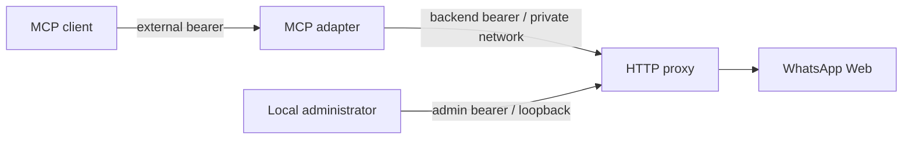

# WhatsApp MCP Gateway

A self-hosted HTTP API and MCP adapter built on Baileys. It supports text, images,
attachments, controlled pairing and newsletter channels. This is an unofficial
WhatsApp Web integration, not the WhatsApp Business Platform API.

Version **3.0.1** requires Node **24.19.0+** for local development. The MCP image
uses Python **3.13**; its pinned dependencies require Python 3.11 or newer for
local tests. Prebuilt release images target **linux/amd64**.

## Architecture



The proxy owns the WhatsApp session and durable outbox. MCP never mounts session
or configuration data. Its staged media files are temporary and capability-bound.
The default Compose file publishes no host ports; local access is an explicit
loopback override. TLS/public routing, if needed, belongs to your trusted ingress.

## Quickstart: build from public source

Requirements: Git, Node 24.19.0+ (for the credential helper), Docker Engine and
Docker Compose v2.24+. Run these commands from a fresh checkout:

```sh
git clone https://github.com/davide-vito-grammatica/whatsapp-mcp-gateway.git
cd whatsapp-mcp-gateway
node scripts/init-env.js
npm run docker:build
npm run docker:start
curl --fail http://127.0.0.1:3000/health
npm run status
```

`init-env` creates `docker/.env` with three distinct random secrets and mode 0600.
It refuses to overwrite an existing file and never prints tokens. That file is
ignored by Git. The Docker commands build both images from source, then start
with `--pull never`; no registry account is required. `docker:start` explicitly
includes the optional loopback override. Health does not mean WhatsApp is linked:
status can initially be `connecting` or `disconnected`.

Open **http://127.0.0.1:3000/session/link**. Read the administrative token from your
local credential file in a private editor and enter it in the page. Choose QR or
phone pairing and follow the phone instructions. The page keeps the token only
in memory; do not paste it into a URL, issue or chat. Existing registered sessions
are retained; do not reset/logout simply to resolve a transient connection issue.

Swagger is available at **http://127.0.0.1:3000/api-docs**. Use **Authorize** with
the API token for ordinary calls, or the administrative token for sensitive
operations. All send examples perform real actions if executed against a linked
installation. Quickstart checks only health/status and sends no messages.

## Prebuilt images

The [3.0.1 release](https://github.com/davide-vito-grammatica/whatsapp-mcp-gateway/releases/tag/v3.0.1)
provides the exact tested linux/amd64 images as `images-3.0.1-linux-amd64.tar.gz`,
plus `SHA256SUMS` and `release-metadata.json`. Download the bundle and checksum
file from that release, verify the checksum, and load the images:

```sh
sha256sum -c SHA256SUMS --ignore-missing
gzip -dc images-3.0.1-linux-amd64.tar.gz | docker load
node scripts/init-env.js
docker compose --env-file docker/.env -f docker/docker-compose.yml -f docker/docker-compose.local.yml up -d --pull never --wait
```

Use a fresh checkout for the credential-helper command; an existing `.env` is
preserved and `init-env` will refuse to overwrite it. The bundle carries the
versioned image names used by Compose. Images are also published to
`ghcr.io/davide-vito-grammatica/whatsapp-mcp-gateway` and the `-mcp` sibling. GHCR
visibility is controlled separately by GitHub; use the public release bundle or
source build if anonymous registry pull is unavailable. No private legacy image
is required. Keep exact digests from release metadata for deployment records.

## Authentication and configuration

| Variable | Purpose |
| --- | --- |
| `WHATSAPP_API_TOKEN` | Backend HTTP API bearer, shared only by proxy and MCP |
| `WHATSAPP_ADMIN_TOKEN` | QR, session operations, queue inspection/replay, configuration and group settings |
| `MCP_AUTH_TOKEN` | Separate external MCP transport bearer |
| `MEDIA_ALLOWED_HOSTS` | Exact trusted external HTTPS media hosts; empty rejects external URL downloads |
| `MCP_IMAGE_ALLOWED_HOSTS` | Trusted external image hosts for the MCP legacy URL input |
| `WHATSAPP_ALLOWED_ORIGINS` | Optional trusted browser origins; same-origin management works by default |
| `MCP_ALLOWED_HOSTS` | Allowed MCP HTTP Host values, including the hostname used by your ingress |
| `MCP_ALLOWED_ORIGINS` | Explicit browser origins for MCP; empty by default |

The backend/admin tokens must be different; use three distinct values overall.
The proxy also supports mounted `WHATSAPP_API_TOKEN_FILE` and
`WHATSAPP_ADMIN_TOKEN_FILE`. The distributed Compose uses environment values.
Do not print interpolated Compose configuration: use `docker compose config --quiet`.

The proxy download/upload limit defaults to **10 MiB**. MCP staging defaults to
15 MiB, but does not bypass the proxy limit. Other bounds are documented in
[API and delivery behaviour](docs/API.md). Allowlisting both external media paths
is required when using legacy image URLs. Staged MCP file inputs use the narrowly
configured private callback instead. Arbitrary private/loopback destinations,
redirects and DNS rebinding are rejected. Automatic text link previews are disabled.

On first use, an empty config volume is initialized from `config/config.ini`.
Keep-alive and email notifications are disabled and destinations are empty.
Subsequent starts preserve installed configuration. Edit your private runtime
configuration, not the tracked template, to avoid committing personal data.

## MCP and operations

The adapter listens on port 8766 inside the Compose network at `/mcp`. Connect
through a trusted authenticated ingress, or the opt-in tunnel described in
[MCP setup](docs/MCP.md). The transport token is distinct from any OpenAI or
WhatsApp credential. The server exports read-only status/channel metadata tools
and explicitly non-idempotent send tools.

```sh
npm run docker:logs
npm run docker:stop
```

Both commands preserve persistent volumes. Session keys, message records,
attachments and logs are private data. Protect the Docker host and backups,
monitor volume capacity, and configure suitable file-log retention. Docker
stdout/stderr rotation is bounded in Compose; it does not rotate files in the
application data volume. Some existing application logs include message details.

Use the [upgrade and rollback runbook](docs/OPERATIONS.md) before changing an
installation. A stored `unknown` outcome or an HTTP timeout is not proof of
non-delivery. Never retry a send blindly, and never replay historical queue files
as part of a deployment.

## Development and contribution

```sh
npm ci
npm test
python3 -m venv .venv
. .venv/bin/activate
pip install -r mcp/requirements.txt
python mcp/test_mcp.py
```

The automated suites use mocks/synthetic data. [CONTRIBUTING.md](CONTRIBUTING.md)
describes checks and CI. Normal pushes and fork PRs validate without publishing;
a manual release publishes the same images that passed tests and security scans.

See [SECURITY.md](SECURITY.md) for private vulnerability reporting,
[CHANGELOG.md](CHANGELOG.md) for behavioural changes, and
[THIRD_PARTY_NOTICES.md](THIRD_PARTY_NOTICES.md) for dependency licensing.
Original project source is licensed under [ISC](LICENSE); third-party components
retain their own terms, including GPL/LGPL components in the proxy distribution.
